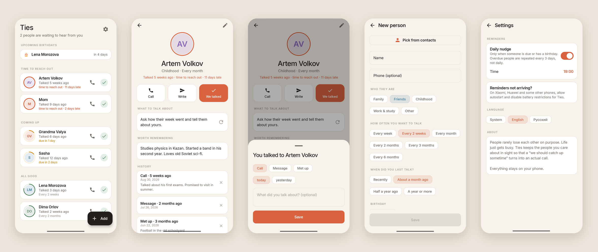

<div align="center">


# Ties

### Don't drift apart from the people who matter

*Friendships rarely end in a fight. They fade quietly: university, a new job, a move, and suddenly a year has passed without a call.*

[](https://github.com/bigdevwhale/ties/actions/workflows/android.yml)
[](https://github.com/bigdevwhale/ties/releases/latest)


[](LICENSE)

**English** · [Русский](README.ru.md) · [Website](https://bigdevwhale.github.io/stillcraft/apps/ties/)



</div>

---

## The idea

Nobody decides to lose touch with their grandma, their best friend from school or the roommate from first year.
It just happens: everyone gets busy, "we should catch up sometime" never gets a date, and the gap grows until calling feels awkward.

Ties is a small, quiet nudge against that. You tell it who matters and how often you'd like to talk.
It keeps them in sight, and when someone has been waiting too long, it reminds you, once, at the time you choose.

## What it does

| | Feature | How it works |
|---|---|---|
| 👥 | **Your people** | Add someone by hand or pick them from contacts. Choose who they are (family, friends, childhood friends, work & study) and a rhythm: every week, two weeks, month, up to every six months. |
| ⭕ | **A ring that cools down** | Every avatar wears a ring that empties as the next contact comes due: green, then amber, then coral. The list is sorted by who has waited longest: *Time to reach out*, *Coming up*, *All good*. |
| 📞 | **One tap to reach out** | Call, or write via SMS, Telegram or WhatsApp right from the card. After a call started in the app, Ties asks "Did you reach them?" when you come back, so logging takes one tap. |
| ✅ | **We talked** | Log a call, a message or a meeting, today or yesterday, with an optional note. The countdown starts over. |
| 💬 | **What to talk about** | The hardest part is the first message. Each card suggests a gentle opener: a shared memory, a song, a 10‑minute call this weekend. |
| 📝 | **Worth remembering** | Notes that make the next conversation warmer: "studies physics in Kazan", "ask about grandma's knee". |
| 🎂 | **Birthdays** | Upcoming birthdays on top of the list and a notification on the day. |
| 🔔 | **One calm reminder a day** | Only if someone is due or has a birthday. People who stay overdue are repeated every 3 days, not daily, so it never turns into noise. |

When you add someone, Ties asks when you last talked (recently, a month ago, half a year, a year or more), so the countdown starts somewhere honest.

## English & Русский

Every screen and every conversation opener is translated, with proper Russian plurals. Switch in **Settings → Language** (System / English / Русский). On Android 13+ the app also shows up in the system's per‑app language settings.

## Download

Get the APK from **[Releases](https://github.com/bigdevwhale/ties/releases/latest)**, or the debug APK attached to any [CI run](https://github.com/bigdevwhale/ties/actions/workflows/android.yml).
Android 8.0 (API 26) or newer.

> [!TIP]
> On Xiaomi (MIUI / HyperOS), Huawei and some other phones the system kills background apps and drops their alarms.
> If reminders don't arrive, allow **Autostart** for Ties and set battery usage to **No restrictions**. *Settings → Reminders not arriving?* opens the right screen.

## Privacy

No accounts, no servers, no analytics. Your people, notes and history live in a local database on the phone.
Ties doesn't read your call log or your whole address book: picking a contact grants access to that one entry only.
Permissions: notifications, and starting after reboot to re‑arm the reminder.

## Under the hood

- **Kotlin + Jetpack Compose**, Material 3 with a custom warm palette (paper `#F7F2EB`, coral `#D9623F`, moss `#5B8A68`, amber `#D08F22`) and the Inter typeface.
- **Room** for people and conversation history · **DataStore** for settings.
- **AlarmManager** (`setAndAllowWhileIdle`, no exact‑alarm permission): one daily check, re‑armed on boot, time changes and every app start.
- The rules (when someone is due, the "soon" window, every‑3‑days nudges, leap‑day birthdays) live in pure Kotlin in `domain/Cadence.kt`, covered by unit tests.
- Per‑app language via `AppCompatDelegate.setApplicationLocales` with an auto‑generated locale config.

```
app/src/main/java/app/ties/
├── domain/      Cadence: due dates, status, warmth, reminders, birthdays (pure Kotlin, unit-tested)
├── data/        Room database (people, touches), DataStore settings
├── reminders/   daily alarm, notification, boot receiver
└── ui/          theme, components, home · person · edit · settings
```

## Build from source

Requirements: JDK 17+ (Android Studio's bundled JBR works) and the Android SDK.

```bash
git clone https://github.com/bigdevwhale/ties.git
cd ties
./gradlew testDebugUnitTest      # unit tests
./gradlew assembleDebug          # app/build/outputs/apk/debug/app-debug.apk
./gradlew installDebug           # install on a connected device
```

### CI / releases

- **Android CI** (`.github/workflows/android.yml`): on every push and PR runs unit tests and lint (missing translations fail the build) and uploads a debug APK.
- **Release** (`.github/workflows/release.yml`): push a tag like `v1.0.0` (or run it manually) to build a release APK and publish it as a GitHub Release.

## License

[MIT](LICENSE) · Inter typeface under the SIL Open Font License 1.1.
