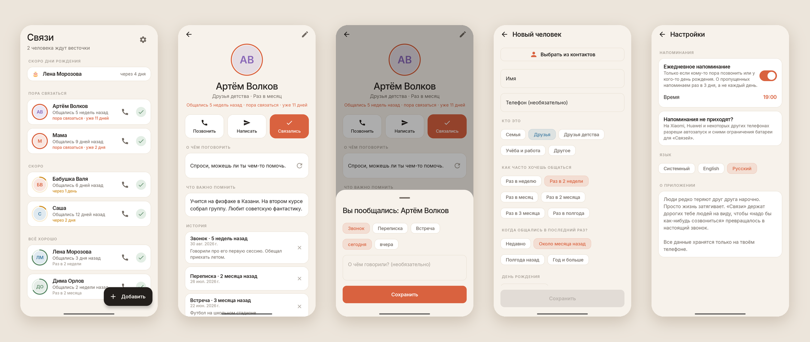

<div align="center">


# Связи · Ties

### Не теряй тех, кто тебе дорог

*Дружба редко заканчивается ссорой. Она тихо угасает: вуз, работа, переезд, и вдруг прошёл год без единого звонка.*

[](https://github.com/bigdevwhale/ties/actions/workflows/android.yml)
[](https://github.com/bigdevwhale/ties/releases/latest)


[](LICENSE)

[English](README.md) · **Русский** · [Сайт](https://bigdevwhale.github.io/stillcraft/apps/ties/)



</div>

---

## Идея

Никто не решает специально перестать общаться с бабушкой, лучшим другом из школы или соседом по общаге.
Это просто происходит: все заняты, «надо бы как-нибудь созвониться» так и не получает даты, а пауза растёт, пока звонить не становится неловко.

«Связи» — маленький тихий противовес этому. Ты указываешь, кто тебе важен и как часто хочешь общаться.
Приложение держит этих людей на виду, а когда кто-то ждёт слишком долго, напоминает. Один раз, в удобное тебе время.

## Что умеет

| | Функция | Как работает |
|---|---|---|
| 👥 | **Твои люди** | Добавь человека вручную или выбери из контактов. Укажи, кто это (семья, друзья, друзья детства, учёба и работа), и ритм: раз в неделю, в две недели, в месяц, вплоть до раза в полгода. |
| ⭕ | **Кольцо, которое остывает** | Вокруг каждого аватара кольцо, которое пустеет по мере приближения срока: зелёное, потом жёлтое, потом коралловое. Список отсортирован по тому, кто ждёт дольше: *Пора связаться*, *Скоро*, *Всё хорошо*. |
| 📞 | **Связаться в одно касание** | Позвонить или написать в SMS, Telegram или WhatsApp прямо из карточки. После звонка из приложения «Связи» спросят «Удалось поговорить?», и отметка займёт одно нажатие. |
| ✅ | **Связались** | Отметь звонок, переписку или встречу, сегодня или вчера, с заметкой по желанию. Отсчёт начнётся заново. |
| 💬 | **О чём поговорить** | Сложнее всего первое сообщение. В карточке есть мягкая подсказка: общее воспоминание, песня, звонок на 10 минут в выходные. |
| 📝 | **Что важно помнить** | Заметки, с которыми следующий разговор будет теплее: «учится на физфаке в Казани», «спросить про бабушкино колено». |
| 🎂 | **Дни рождения** | Ближайшие дни рождения вверху списка и уведомление в сам день. |
| 🔔 | **Одно спокойное напоминание в день** | Только если кому-то пора позвонить или у кого-то день рождения. О пропущенных напоминаем раз в 3 дня, а не каждый день, чтобы это не превратилось в шум. |

При добавлении приложение спрашивает, когда вы общались в последний раз (недавно, месяц назад, полгода, год и больше), чтобы отсчёт сразу был честным.

## English и Русский

Все экраны и подсказки для разговора переведены, с правильными русскими склонениями. Язык меняется в **Настройки → Язык** (Системный / English / Русский). На Android 13+ приложение есть и в системных настройках языка для отдельных приложений.

## Скачать

APK — в **[Releases](https://github.com/bigdevwhale/ties/releases/latest)**, или debug‑APK из любого [запуска CI](https://github.com/bigdevwhale/ties/actions/workflows/android.yml).
Android 8.0 (API 26) или новее.

> [!TIP]
> Xiaomi (MIUI / HyperOS), Huawei и некоторые другие телефоны убивают фоновые приложения вместе с их будильниками.
> Если напоминания не приходят, разреши «Связям» **автозапуск** и сними **ограничения батареи**. Кнопка *Настройки → Напоминания не приходят?* открывает нужный экран.

## Приватность

Без аккаунтов, серверов и аналитики. Люди, заметки и история хранятся в локальной базе на телефоне.
Приложение не читает журнал звонков и всю телефонную книгу: при выборе контакта открывается доступ только к нему.
Разрешения: уведомления и запуск после перезагрузки, чтобы заново поставить напоминание.

## Как устроено

- **Kotlin + Jetpack Compose**, Material 3 с собственной тёплой палитрой (бумага `#F7F2EB`, коралл `#D9623F`, мох `#5B8A68`, янтарь `#D08F22`) и шрифтом Inter.
- **Room** для людей и истории общения · **DataStore** для настроек.
- **AlarmManager** (`setAndAllowWhileIdle`, без разрешения на точные будильники): одна проверка в день, перевзводится после перезагрузки, смены времени и при каждом запуске.
- Правила (когда пора связаться, окно «скоро», напоминания раз в 3 дня, дни рождения 29 февраля) — чистый Kotlin в `domain/Cadence.kt`, покрыты юнит‑тестами.
- Язык приложения через `AppCompatDelegate.setApplicationLocales` с автогенерируемым locale config.

## Сборка из исходников

Нужны JDK 17+ (подойдёт JBR из Android Studio) и Android SDK.

```bash
git clone https://github.com/bigdevwhale/ties.git
cd ties
./gradlew testDebugUnitTest      # юнит-тесты
./gradlew assembleDebug          # app/build/outputs/apk/debug/app-debug.apk
./gradlew installDebug           # установить на подключённый телефон
```

## Лицензия

[MIT](LICENSE) · Шрифт Inter под SIL Open Font License 1.1.
